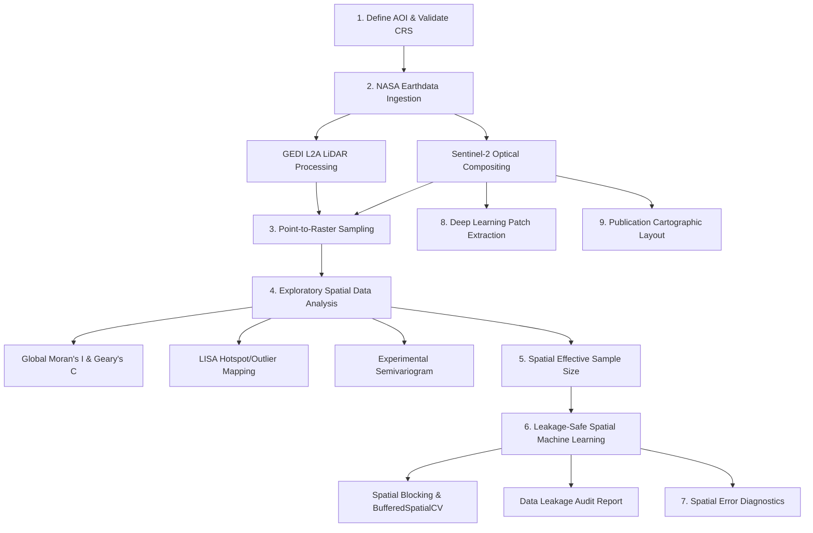

# Comprehensive End-to-End Tutorial: Remote Sensing, Spatial Statistics & Spatial ML

This tutorial guides you through a complete, rigorous scientific research workflow in **GeoFlow** (`gf`). 

We will model **forest canopy height** using spaceborne NASA GEDI LiDAR, multi-spectral Sentinel-2 satellite imagery, rigorous spatial statistics to prevent pseudoreplication, and leakage-safe spatial machine learning with publication-quality cartography.

---

## Tutorial Overview



---

## 1. Study Area Setup & Coordinate System Validation

We define a study area in the biodiverse hill forest tract of Southeastern Bangladesh (Chattogram region) using WGS84 coordinates:

```python
import geoflow as gf

# 1. Define Area of Interest (AOI) bounding box [minx, miny, maxx, maxy]
aoi = gf.Rectangle([91.7, 22.2, 92.0, 22.5], crs="EPSG:4326")

print(f"AOI Extent: {aoi.bounds}")
print(f"Area in sq degrees: {aoi.area:.4f}")
print(f"Centroid: ({aoi.centroid().shapely.x:.3f}, {aoi.centroid().shapely.y:.3f})")
```

---

## 2. Satellite Data Acquisition: Sentinel-2 & GEDI LiDAR

### Step 2A: Harmonized Landsat-Sentinel (HLS) Multi-Spectral Imagery

Search and stream or download cloud-filtered optical satellite imagery:

```python
# Authenticate with NASA Earthdata (interactive prompt or .netrc)
gf.auth.login(strategy="interactive")

# Option A: Ingest and download from NASA Earthdata (Harmonized Sentinel-2)
sentinel_collection = gf.ImageCollection.from_earthdata(
    dataset="SENTINEL-2",
    region=aoi,
    start="2023-01-01",
    end="2023-03-31",
    bands=["B02", "B03", "B04", "B08", "B11", "B12"],
    cloud_cover=(0.0, 15.0),
    limit=5
)

# Option B: Cloud-Native Lazy STAC Streaming (Zero download)
# sentinel_collection = gf.ImageCollection.from_stac(
#     collection="sentinel-2-l2a",
#     catalog="planetary-computer",
#     geometry=aoi,
#     start="2023-01-01",
#     end="2023-03-31",
#     bands=["B02", "B03", "B04", "B08"]
# )

print(f"Acquired {len(sentinel_collection)} optical granules.")
```

### Step 2B: Temporal Compositing & Spectral Indices

We reduce the time-series using a pixel-wise median composite and compute vegetation indices:

```python
# Create cloud-free median composite clipped to our study area
composite = (
    sentinel_collection
    .filterBounds(aoi)
    .median()
    .clip(aoi)
)

# Rename to standard band names if using HLS naming conventions
if "B04" in composite.bands:
    composite = composite.rename(["B2", "B3", "B4", "B8", "B11", "B12"])

# Compute vegetation & moisture indices
ndvi = composite.ndvi(nir="B8", red="B4")
ndwi = composite.ndwi(green="B3", nir="B8")

print(f"Composite dimensions: {composite.height} x {composite.width} pixels across {composite.count} bands.")
```

### Step 2C: NASA GEDI LiDAR Canopy Height Footprints

Extract 25m footprint canopy top heights ($RH98$) from NASA GEDI Level-2A:

```python
# Download GEDI Level-2A granules over our AOI (needs gf.login(); granules are large)
gedi = (
    gf.GEDI("L2A")
    .filterBounds(aoi)
    .filterDate("2022-01-01", "2022-12-31")
    .filterQuality()  # Retain high-sensitivity, non-degraded shots
    .select(["shot_number", "rh98", "rh50", "sensitivity", "elevation"])
    .load(limit=2)
)

# Convert footprint points to a GeoPandas GeoDataFrame and FeatureCollection
gedi_gdf = gedi.to_geodataframe()
gedi_fc = gedi.to_feature_collection()

print(f"Extracted {len(gedi_gdf)} valid LiDAR shots.")
print(gedi_gdf[["shot_number", "rh98", "sensitivity"]].head())
```

---

## 3. Spatial Intersections & Point-to-Raster Sampling

To train predictive models, we need the multi-spectral reflectance and vegetation index values extracted directly underneath each 25-meter GEDI LiDAR shot:

```python
# Sample multi-band satellite data at each LiDAR footprint location
sampled_fc = gedi_fc.sample_raster(
    image=composite,
    bands=["B2", "B3", "B4", "B8", "B11", "B12"]
)

# Also append NDVI to the attribute table
sampled_fc = sampled_fc.sample_raster(image=ndvi, bands=["NDVI"])

# Convert to a standard Pandas DataFrame for statistical modeling
df = sampled_fc.to_dataframe()
print(df[["shot_number", "rh98", "NDVI", "B8", "B4"]].dropna().head())
```

---

## 4. Exploratory Spatial Data Analysis (ESDA)

Before fitting any machine learning model, we must test for **spatial autocorrelation**. Nearby forest plots are not independent; treating them as i.i.d. causes false confidence.

### Global Moran's I & Geary's C

```python
# Compute Global Moran's I using an 8-nearest neighbor spatial weights matrix
moran = gf.spatial.morans_i(sampled_fc, value="rh98", k=8)
print(moran.summary())

# Compute Geary's C
geary = gf.spatial.gearys_c(sampled_fc, value="rh98", k=8)
print(f"Geary's C: {geary:.4f}")
```

If $p < 0.05$ and $I > 0$, our canopy height observations exhibit statistically significant spatial clustering.

### Local Spatial Autocorrelation (LISA Clusters)

Identify local hotspots (High-High), coldspots (Low-Low), and spatial outliers (High-Low, Low-High):

```python
# Compute LISA statistics
lisa_gdf = gf.spatial.local_morans_i(sampled_fc, value="rh98", k=8, p_threshold=0.05)

# Review cluster distribution
print("LISA Spatial Clusters:")
print(lisa_gdf["cluster"].value_counts())
```

### Empirical Semivariogram Modeling

Model the distance over which canopy height remains autocorrelated:

```python
# Calculate semivariogram out to 15 distance lags
variogram = gf.spatial.variogram(sampled_fc, value="rh98", n_lags=15)

print(f"Estimated Nugget variance: {variogram.nugget:.3f}")
print(f"Estimated Sill plateau   : {variogram.sill:.3f}")

# Plot experimental semivariogram
ax = variogram.plot(title="Canopy Height Spatial Dependence (Semivariogram)")
```

---

## 5. Preventing Pseudoreplication with Spatial Effective Sample Size (ESS)

When sample points are autocorrelated, sample size is deceptively large. GeoFlow calculates the **Effective Sample Size ($N_{\text{eff}}$)**:

```python
ess_report = gf.stats.effective_sample_size(sampled_fc, value="rh98")

print(f"Nominal Sample Count (N)  : {ess_report['nominal_n']}")
print(f"Effective Sample Size (N_eff): {ess_report['effective_n']}")
print(f"Design Effect (N / N_eff) : {ess_report['design_effect']:.2f}")
print(f"Pseudoreplication Alert   : {ess_report['pseudoreplication_risk']}")
```

### Spatial Hypothesis Testing

Test whether canopy heights differ across forest density zones while accounting for spatial autocorrelation:

```python
# Classify points into high vs low vegetation based on NDVI median
median_ndvi = df["NDVI"].median()
df["veg_class"] = (df["NDVI"] > median_ndvi).map({True: "Dense", False: "Sparse"})

# Run hypothesis test with automated spatial autocorrelation alerts
stat_test = gf.stats.test(df, value="rh98", group="veg_class")
print(stat_test.summary())
```

---

## 6. Leakage-Safe Spatial Machine Learning

### The Trap: Random Train/Test Splits
If you use standard `train_test_split(test_size=0.2)`, validation points will sit only meters away from training points. Models "memorize" neighboring pixels rather than generalizable physical features.

### The Solution: Hexagonal Spatial Blocking & Buffered Spatial CV

```python
# 1. Partition study area into 5 km hexagonal blocks
blocks = gf.spatial.block(aoi, size=5000.0, unit="meters", shape="hexagonal")

# Project samples to local metric coordinates (e.g. UTM) for metric buffers
samples_utm = sampled_fc.gdf.to_crs(blocks.crs.to_string())

# 2. Configure Buffered Spatial Cross-Validation with a 1500m dead-zone
cv = gf.validation.BufferedSpatialCV(
    buffer_distance=1500.0, # 1.5 km spatial exclusion buffer
    blocks=blocks,
    n_splits=5,
    random_state=42
)

# 3. Audit first fold for spatial leakage
train_idx, val_idx = next(cv.split(samples_utm))
train_partition = samples_utm.iloc[train_idx]
val_partition = samples_utm.iloc[val_idx]

audit = gf.validation.leakage_report(
    train=train_partition,
    test=val_partition,
    buffer_threshold=1500.0
)
print(audit.summary())
```

### Train and Evaluate a Predictive Model

```python
from sklearn.ensemble import RandomForestRegressor

features = ["B2", "B3", "B4", "B8", "B11", "B12", "NDVI"]
target = "rh98"

X_train = train_partition[features].dropna()
y_train = train_partition.loc[X_train.index, target]

X_val = val_partition[features].dropna()
y_val = val_partition.loc[X_val.index, target]

model = RandomForestRegressor(n_estimators=100, random_state=42)
model.fit(X_train, y_train)

y_pred = model.predict(X_val)
```

---

## 7. Spatial Error Diagnostics (Residual Autocorrelation)

Conventional ML packages only report RMSE and $R^2$. GeoFlow tests the model's **residuals** for spatial bias:

```python
val_geoms = val_partition.loc[X_val.index, "geometry"]

eval_report = gf.validation.evaluate_spatial(
    y_true=y_val,
    y_pred=y_pred,
    geometry=val_geoms,
    k=8
)

print(eval_report.summary())

# Plot residual map to visually inspect spatial bias
eval_report.residual_map()
```

If the residuals show no significant Moran's I, the model has generalized cleanly across geography without omitting spatial drivers.

---

## 8. Deep Learning Patch Extraction (PyTorch Ready)

For convolutional neural networks (U-Net, ResNet, Vision Transformers), GeoFlow extracts multi-channel image patches and returns PyTorch data loaders:

```python
# Create patch dataset: 64x64 pixel windows with stride 32
patch_ds = gf.ml.PatchDataset(
    image=composite,
    patch_size=64,
    stride=32
)

print(f"Total extracted spatial patches: {len(patch_ds)}")

# Split into train, val, test subsets using spatial blocking
train_ds, val_ds, test_ds = patch_ds.split(
    strategy="spatial",
    blocks=blocks,
    ratios=(0.7, 0.15, 0.15)
)

# Generate mini-batch PyTorch DataLoader (or NumPy iterator)
train_loader = train_ds.dataloader(batch_size=16, shuffle=True)

for batch in train_loader:
    # batch shape: (16, bands, 64, 64)
    print(f"Mini-batch tensor shape: {batch.shape}")
    break
```

---

## 9. Publication Cartography & Interactive Layout Editor

### Standalone Publication Map Export

Generate a 300 DPI publication map featuring a dynamic metric scale bar, 3D North arrow, and 4-sided graticule degree ticks:

```python
ndvi.plot_map(
    cmap="RdYlGn",
    vmin=-0.1,
    vmax=0.85,
    title="Forest Vegetation Index (NDVI) — Chattogram Region",
    subtitle="Sentinel-2 MSI Level-2A | WGS84 Datum",
    colorbar_label="NDVI",
    
    # 4-Sided Graticule with Vertical Latitudes
    show_top=True,
    show_right=True,
    show_bottom=True,
    show_left=True,
    lat_orientation="vertical",
    prune_corners=True,
    degree_precision=3,
    
    # Cartographic elements
    north_arrow=True,
    scale_bar=True,
    grid=True,
    
    save_path="publication_chattogram_ndvi.png",
    dpi=300
)
```

### Interactive Layout Editor in Notebooks

Launch the ArcGIS-style interactive Layout Editor directly in your Jupyter or Google Colab notebook:

```python
# Launch interactive widget
editor = ndvi.edit_layout(
    title="Chittagong Hill Forest Reserve",
    subtitle="Normalized Difference Vegetation Index",
    cmap="RdYlGn"
)

# Display in notebook cell
editor
```

---

## 10. Summary & Next Steps

In this tutorial, you completed a complete end-to-end scientific pipeline:
1. **Acquired** satellite data via Earthdata and GEDI LiDAR.
2. **Computed** spectral indices and sampled raster values at point locations.
3. **Diagnosed** spatial autocorrelation with Moran's I and LISA clustering.
4. **Corrected** for spatial pseudoreplication using Spatial Effective Sample Size.
5. **Eliminated** data leakage with `BufferedSpatialCV` and leakage audits.
6. **Evaluated** regression residuals for spatial independence.
7. **Exported** PyTorch deep learning patches and publication-grade cartographic maps.

Explore the [API Reference](../api_reference/raster.md) for full method signatures, or read the [Contributor Guide](../contributing.md) to contribute new algorithms to GeoFlow!
