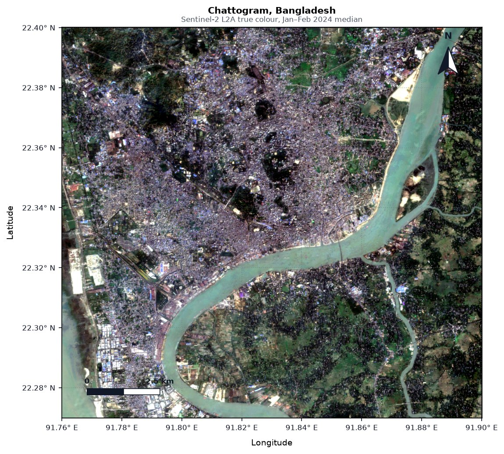
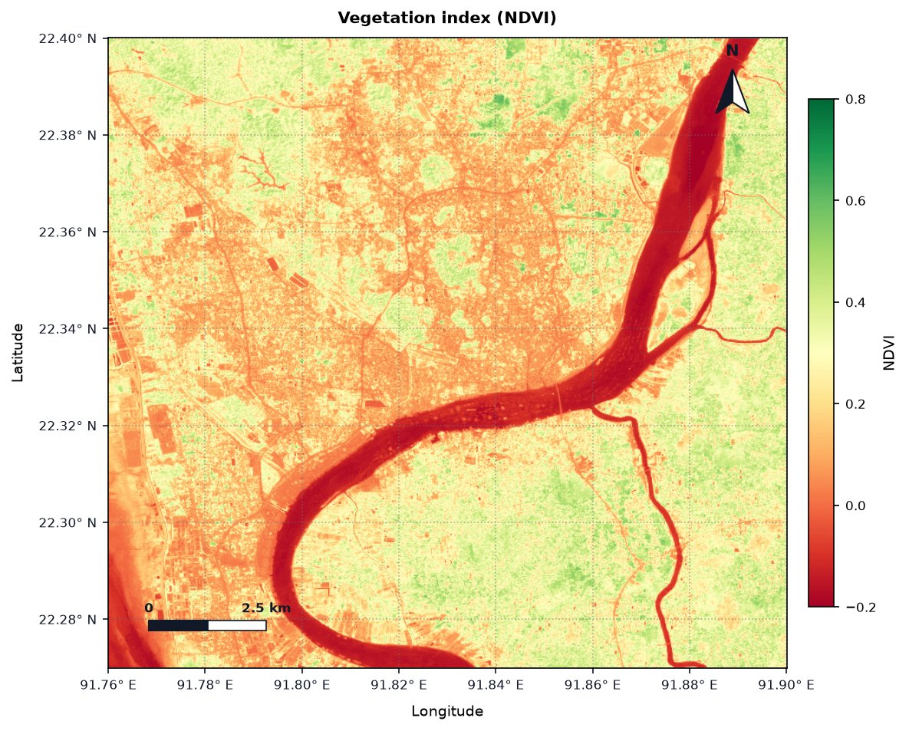
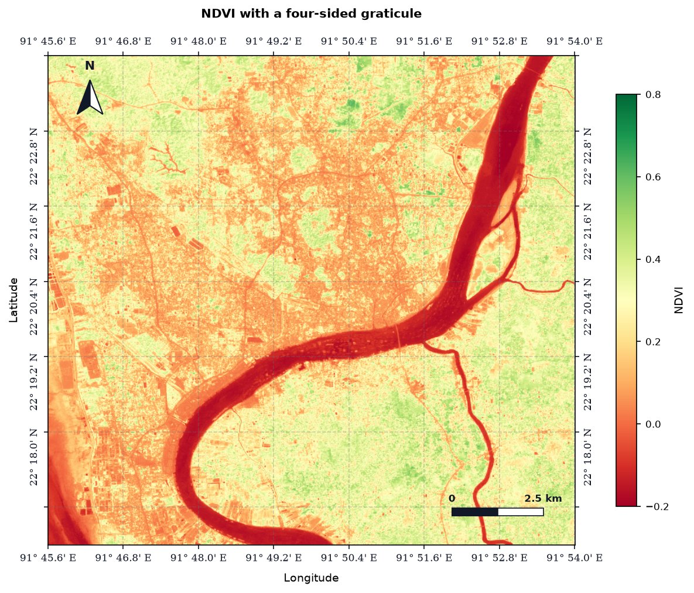
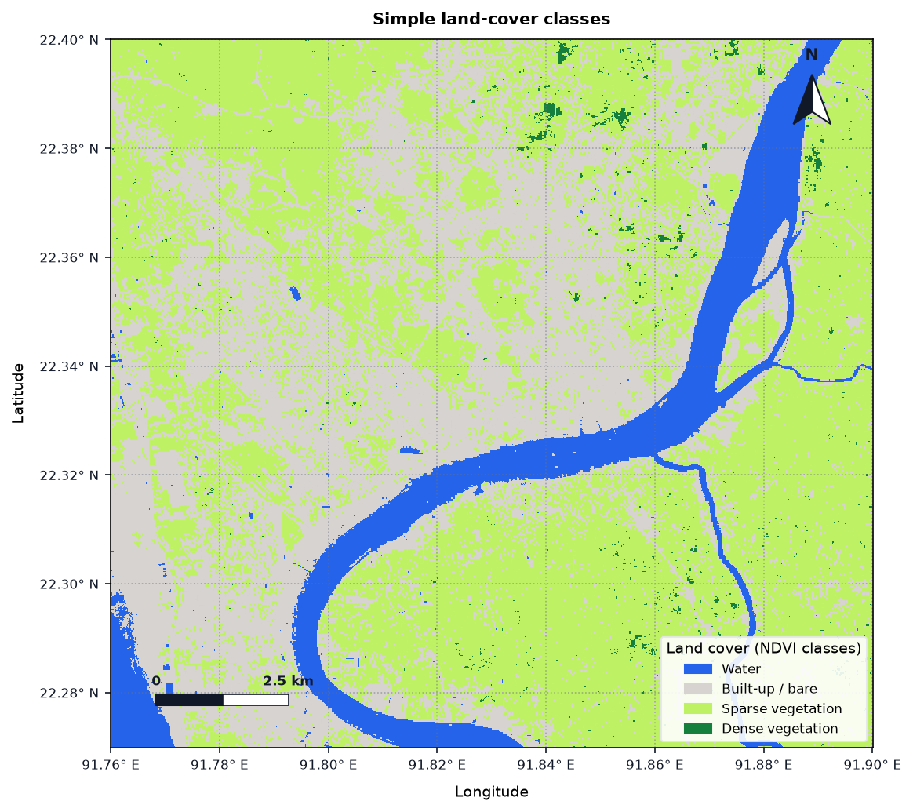
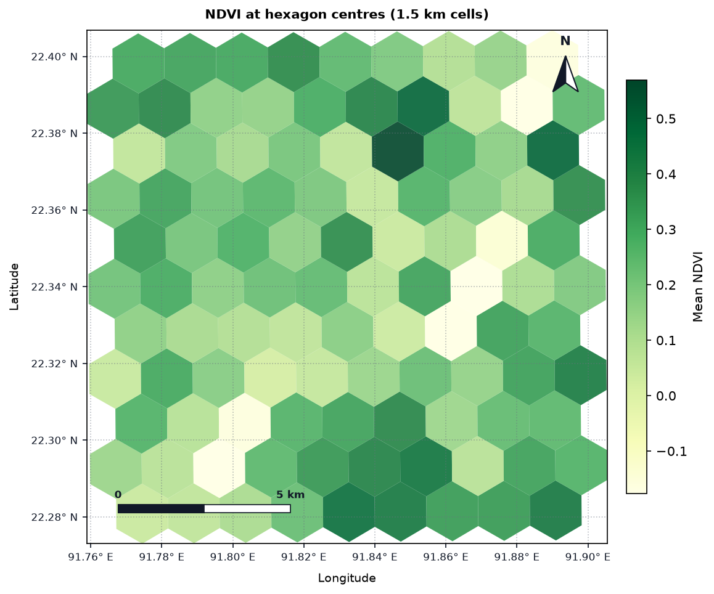
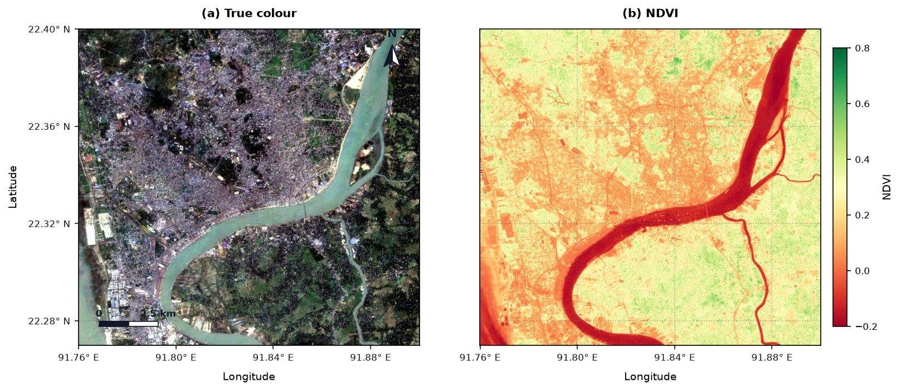
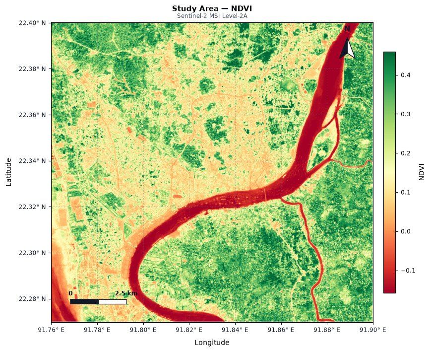

# Tutorial: Making Maps with GeoFlow

This tutorial builds seven publication-ready maps of **Chattogram, Bangladesh** from free Sentinel-2 imagery. Every map on this page was produced by the code shown, exactly as written.

**You'll learn to:**

- load a cloud-free satellite composite in a few lines
- make true-colour and index maps with north arrows, scale bars and coordinates
- style the graticule (coordinate grid) for journals
- make classified maps with legends, and vector (polygon) maps
- combine maps into multi-panel figures
- design a layout interactively in a notebook

**Requirements:** `pip install "geoflow[stac] @ git+https://github.com/ramiz-moktader/geoflow.git"` and an internet connection. No account or login is needed, because the imagery comes from [Microsoft Planetary Computer](https://planetarycomputer.microsoft.com/). It runs in Jupyter, VS Code or Google Colab.

---

## Step 1: Choose your area

Maps start with an area of interest (AOI). `gf.Rectangle` takes `[west, south, east, north]` in degrees:

```python
import geoflow as gf

aoi = gf.Rectangle([91.76, 22.27, 91.90, 22.40], crs="EPSG:4326")  # Chattogram city and the Karnaphuli river
```

!!! tip "Use your own area"
    Find coordinates by right-clicking a spot in Google Maps, or draw a box at [bboxfinder.com](http://bboxfinder.com). Keep the box under about 30 × 30 km while you experiment: larger areas take longer to load. You can also load a boundary file with `gf.Geometry.from_file("study_area.geojson")`.

## Step 2: Load a cloud-free Sentinel-2 composite

```python
s2 = gf.ImageCollection.from_stac(
    collection="sentinel-2-l2a",
    catalog="planetary-computer",
    geometry=aoi,
    start="2024-01-01",
    end="2024-02-29",                          # dry season: fewest clouds over Bangladesh
    bands=["B02", "B03", "B04", "B08", "SCL"],  # blue, green, red, near-infrared, scene classification
    resolution=20,                             # pixel size in metres
)
image = s2.mask_clouds().median().clip(aoi)
```

What each part does:

- `from_stac(...)` finds every Sentinel-2 scene over the AOI in those dates (24 here) and streams only the pixels inside the box.
- `mask_clouds()` uses the `SCL` band to remove cloudy and shadowed pixels from each scene.
- `median()` takes the middle value of each pixel across all scenes, which removes any leftover clouds.
- `clip(aoi)` trims the result to your box.

## Step 3: True-colour map

```python
image.plot_map(
    bands=["B04", "B03", "B02"],  # red, green, blue
    title="Chattogram, Bangladesh",
    subtitle="Sentinel-2 L2A true colour, Jan–Feb 2024 median",
    save_path="01_true_color.png",
)
```



One call adds the **north arrow**, a **scale bar** whose length is computed for your latitude, **degree-formatted coordinates** and a light **grid**. Colours are stretched automatically between the 2nd and 98th percentile, so the image is never too dark or washed out. `save_path` writes a 300 DPI file by default: change it with `dpi=600` for print.

## Step 4: Vegetation index map with a colour bar

```python
ndvi = image.ndvi()  # finds the NIR (B08) and red (B04) bands automatically

ndvi.plot_map(
    cmap="RdYlGn",          # red = bare/water, green = vegetation
    vmin=-0.2, vmax=0.8,    # fix the colour range so different maps are comparable
    title="Vegetation index (NDVI)",
    colorbar_label="NDVI",
    save_path="02_ndvi.png",
)
```



Other indices work the same way: `image.ndwi()` (water), `image.ndbi()` (built-up), `image.evi()`, `image.nbr()` (burn severity). Any [Matplotlib colour map](https://matplotlib.org/stable/users/explain/colors/colormaps.html) name works for `cmap`.

## Step 5: Style the graticule for publication

Journals often want coordinates on all four sides, latitude labels rotated, degrees-and-minutes, and a serif font:

```python
ndvi.plot_map(
    cmap="RdYlGn", vmin=-0.2, vmax=0.8,
    title="NDVI with a four-sided graticule",
    colorbar_label="NDVI",
    show_top=True, show_right=True,   # labels on all four sides
    lat_orientation="vertical",       # rotate latitude labels to run along the frame
    coord_format="DM",                # degrees and minutes: "DD", "DM" or "DMS"
    corner_threshold=0.1,             # hide labels within 10% of a corner so they don't collide
    tick_fontfamily="serif",
    tick_fontsize=8,
    grid_style="--", grid_alpha=0.3,  # dashed, faint grid lines
    north_loc="top-left",             # move the north arrow ...
    scale_loc="bottom-right",         # ... and the scale bar
    save_path="03_graticule.png",
)
```



!!! tip "Overlapping corner labels?"
    Labels near the corners are hidden when they fall within `corner_threshold` of a corner (2.5% of the map by default). Rotated or long labels such as `22° 16.8' N` need more room, so raise it to `0.1` as above. Use `prune_corners="x"` or `"y"` to hide only one axis's corner labels, or `graticule_interval=0.02` to set the label spacing in degrees yourself.

## Step 6: Classified map with a legend

Turn continuous values into classes with `discrete_bins` (the class boundaries) and `discrete_colors`, and label them with `legend_labels`:

```python
classes = {
    "Water": "#2563eb",
    "Built-up / bare": "#d6d3d1",
    "Sparse vegetation": "#bef264",
    "Dense vegetation": "#15803d",
}
ndvi.plot_map(
    discrete_bins=[-1.0, 0.0, 0.2, 0.5, 1.0],  # 4 classes need 5 boundaries
    discrete_colors=list(classes.values()),
    legend_labels=classes,
    legend_title="Land cover (NDVI classes)",
    legend_loc="lower right",
    title="Simple land-cover classes",
    save_path="04_classes.png",
)
```



Boundaries are inclusive on the left: here `0.0 ≤ NDVI < 0.2` is "Built-up / bare". These NDVI thresholds are a simple illustration. For a real land-cover map, train a classifier on labelled samples (see [Machine Learning & Validation](04_machine_learning.md)).

## Step 7: Vector map: summarise by hexagon

`plot_map` also works on vector data (`gf.FeatureCollection`). Pass the column to colour by in `bands` and `legend=True` for a colour bar. Here we cover the area with 1.5 km hexagons and colour each by the NDVI at its centre:

```python
hexes = gf.spatial.block(aoi, size=1500, unit="meters", shape="hexagonal")
gdf = hexes.to_geodataframe()

# NDVI value at each hexagon's centre point (centroids computed in metres, UTM zone 46N)
centres = gf.FeatureCollection(gdf.set_geometry(gdf.to_crs(32646).centroid.to_crs(4326)))
gdf["mean_ndvi"] = centres.sample_raster(ndvi).to_geodataframe()["NDVI"].values

gf.FeatureCollection(gdf.dropna(subset=["mean_ndvi"])).plot_map(
    bands=["mean_ndvi"],
    cmap="YlGn",
    legend=True,
    colorbar_label="Mean NDVI",
    title="NDVI at hexagon centres (1.5 km cells)",
    save_path="05_hexagons.png",
)
```



The same works for any polygons, lines or points: district boundaries from a shapefile (`gf.FeatureCollection("districts.shp")`), GPS survey points, or GEDI LiDAR shots.

## Step 8: Multi-panel figure

Pass a Matplotlib axis with `ax=` to place several maps in one figure:

```python
import matplotlib.pyplot as plt

fig, (ax1, ax2) = plt.subplots(1, 2, figsize=(11, 4.8))
image.plot_map(bands=["B04", "B03", "B02"], title="(a) True colour", ax=ax1,
               graticule_interval=0.04)
ndvi.plot_map(cmap="RdYlGn", vmin=-0.2, vmax=0.8, title="(b) NDVI", colorbar_label="NDVI",
              ax=ax2, graticule_interval=0.04,
              north_arrow=False, scale_bar=False, show_left=False)  # avoid repeating elements
fig.savefig("06_two_panel.png", dpi=300, bbox_inches="tight")
```



`graticule_interval=0.04` puts a label every 0.04° so the smaller panels don't get crowded. Shared elements such as the north arrow and scale bar only need to appear once.

## Step 9: Design the layout interactively

In a notebook (Jupyter, VS Code or Google Colab), `edit_layout()` opens a layout designer, similar to the print layout view in ArcGIS Pro or QGIS. This example loads a GeoTIFF you already have, here one uploaded to Colab:

```python
import geoflow as gf

img = gf.Image("/content/Sentinel2_Chattogram_2025_01_25.tif")

# Launch the interactive Layout Editor
editor = img.ndvi().edit_layout(
    title="Study Area — NDVI",
    subtitle="Sentinel-2 MSI Level-2A",
    cmap="RdYlGn",
)

# Display the editor widget in the notebook
editor
```

The editor shows a live preview next to tabs of controls:

| Tab | What you can change |
|---|---|
| 📄 **Page Setup** | Canvas size (square, landscape, Nature single/double column), title and subtitle |
| 🧭 **Carto** | North arrow and scale bar: show/hide, corner or exact X/Y position, size, scale bar length |
| 🗺️ **Frame** | Zoom, pan, or type the exact map extent in coordinates |
| 🌐 **Graticule** | Coordinate labels on each side, orientation, decimal precision, grid style |
| 🎨 **Colors** | 15+ colour maps, stretch limits, colour bar |
| 💾 **Export Canvas** | Paper size and orientation, save at 300 or 600 DPI, one-click download in Colab, and **📋 Python Code** to get the equivalent `plot_map(...)` call |

The preview starts from the same defaults as `plot_map`. With the settings above, the starting map looks like this:



!!! tip "From the editor to a script"
    When the layout looks right, use **Export Canvas → 📋 Python Code** and paste the `plot_map(...)` call into your script. Your figure is then reproducible and can be regenerated whenever the data changes.

!!! note "Using your own GeoTIFF"
    `gf.Image("file.tif")` opens any GeoTIFF, for example one exported from Google Earth Engine or downloaded from USGS EarthExplorer. To save GeoFlow imagery as a GeoTIFF, use `image.save("composite.tif")`. In Colab, upload files with the 📁 **Files** panel on the left; they appear under `/content/`.

---

## Quick reference

| Goal | Parameters |
|---|---|
| Choose bands / colours | `bands=[...]`, `cmap=`, `vmin=`, `vmax=` |
| Titles | `title=`, `subtitle=`, `title_fontsize=`, `subtitle_fontsize=` |
| North arrow | `north_arrow=`, `north_loc=` (`"top-right"`, `"top-left"`, ...), `north_pos=(x, y)`, `north_size=` |
| Scale bar | `scale_bar=`, `scale_loc=`, `scale_pos=(x, y)`, `scale_fraction=`, `scale_custom_length_m=` |
| Coordinates | `coord_format=` (`"DD"`, `"DM"`, `"DMS"`), `degree_precision=`, `graticule_interval=`, `show_top/bottom/left/right=` |
| Label style | `lat_orientation=`, `lon_orientation=`, `tick_fontsize=`, `tick_fontfamily=`, `tick_color=` |
| Corner collisions | `prune_corners=` (`True`, `"x"`, `"y"`, `"both"`), `corner_threshold=` |
| Grid | `grid=`, `grid_style=`, `grid_color=`, `grid_alpha=` |
| Colour bar / legend | `colorbar=`, `colorbar_label=`, `legend=`, `legend_labels=`, `legend_title=`, `legend_loc=` |
| Classes | `discrete_bins=`, `discrete_colors=` |
| Output | `save_path=`, `dpi=`, `ax=` (multi-panel) |

The full list with defaults is in the [Visualization & Cartography API reference](../api_reference/viz.md).
